# Nghiệp vụ hệ thống ngân hàng microservice

Tài liệu mô tả nghiệp vụ dựa trên code hiện tại (controller, service, enum, DTO và script `database/oracle/`).
Phần kỹ thuật chỉ được nhắc đến khi nó ảnh hưởng tới hành vi nghiệp vụ.

---

## 1. Tổng quan

Hệ thống hỗ trợ các nghiệp vụ ngân hàng bán lẻ cơ bản:

- Đăng ký và đăng nhập người dùng, phân quyền theo vai trò.
- Quản lý hồ sơ khách hàng và xác thực danh tính (KYC).
- Mở và quản lý tài khoản thanh toán / tiết kiệm, ghi sổ cái.
- Chuyển khoản giữa hai tài khoản, nộp tiền và rút tiền tại quầy.
- Gửi thông báo kết quả giao dịch qua SMS / email.

| Service | Nghiệp vụ phụ trách | Schema Oracle |
|---|---|---|
| `auth-service` | Người dùng, đăng nhập, token, role/permission | `BANK_AUTH` |
| `customer-service` | Hồ sơ khách hàng, giấy tờ KYC | `BANK_CUSTOMER` |
| `account-service` | Tài khoản, số dư, sổ cái; thực hiện trừ/cộng/hoàn tiền | `BANK_ACCOUNT` |
| `transaction-service` | Tiếp nhận giao dịch, điều phối Saga, chống trùng | `BANK_TRANSACTION` |
| `notification-service` | Gửi thông báo theo mẫu, gửi lại khi lỗi | `BANK_NOTIFICATION` |
| `api-gateway` | Điểm vào duy nhất, kiểm tra token, giới hạn tần suất | — |

---

## 2. Tác nhân và phân quyền

### 2.1 Vai trò (role)

| Role | Ý nghĩa |
|---|---|
| `CUSTOMER` | Khách hàng tự sử dụng dịch vụ. Người tự đăng ký được gán role này. |
| `TELLER` | Giao dịch viên tại quầy: quản lý khách hàng, mở tài khoản, nộp/rút tiền. |
| `ADMIN` | Quản trị hệ thống, có toàn bộ quyền. |
| `SERVICE` | Danh tính nội bộ giữa các service (token sống 1 phút), không cấp cho người dùng và không gọi được REST. |

### 2.2 Ma trận quyền (seed trong `01_auth_schema.sql`)

| Permission | Ý nghĩa | CUSTOMER | TELLER | ADMIN |
|---|---|:-:|:-:|:-:|
| `ACCOUNT_READ` | Xem tài khoản | ✔ | ✔ | ✔ |
| `ACCOUNT_CREATE` | Mở tài khoản | | ✔ | ✔ |
| `ACCOUNT_UPDATE` | Cập nhật / khóa tài khoản | | ✔ | ✔ |
| `TRANSFER_CREATE` | Thực hiện giao dịch | ✔ | ✔ | ✔ |
| `TRANSACTION_READ` | Xem giao dịch | ✔ | ✔ | ✔ |
| `CUSTOMER_READ` | Xem thông tin khách hàng | ✔ | ✔ | ✔ |
| `CUSTOMER_MANAGE` | Quản lý khách hàng, KYC | | ✔ | ✔ |
| `USER_MANAGE` | Quản lý user, role | | | ✔ |
| `OPERATION_MANAGE` | Vận hành: giao dịch lỗi, outbox, DLT, đối soát (mục 10.9) | | | ✔ |

Ngoài permission, một số API yêu cầu role:

- Nộp/rút tiền và xem danh sách tài khoản theo `customerId`: phải là `TELLER` hoặc `ADMIN`.
- Quản lý mẫu thông báo: chỉ `ADMIN`.

### 2.3 Quy tắc sở hữu dữ liệu

- Khách hàng chỉ xem/thao tác được dữ liệu của chính mình: hồ sơ, giấy tờ KYC, tài khoản, sổ cái, giao dịch và thông báo.
  Hệ thống so `customerId` của dữ liệu với hồ sơ khách hàng gắn với user đang đăng nhập.
- Nhân viên (`TELLER`, `ADMIN`) được bỏ qua kiểm tra sở hữu.
- Khi tra cứu tài khoản của người khác (ví dụ tài khoản nhận lúc chuyển khoản), hệ thống chỉ trả thông tin cơ bản và **ẩn số dư**.

---

## 3. Người dùng và xác thực (auth-service)

### 3.1 Đăng ký — `POST /api/auth/register` (công khai)

- `username`: 4–50 ký tự, chỉ gồm chữ, số, dấu chấm, gạch dưới; không được trùng.
- `password`: 8–100 ký tự, phải có cả chữ và số; lưu dạng hash.
- `email`: đúng định dạng, tối đa 150 ký tự; không được trùng.
- User mới có trạng thái `ACTIVE` và role `CUSTOMER`.

### 3.2 Đăng nhập — `POST /api/auth/login` (công khai)

- Thành công: trả về access token (hiệu lực 15 phút) và refresh token (hiệu lực 7 ngày). Bộ đếm sai mật khẩu được reset.
- Sai mật khẩu: tăng bộ đếm. Sai đủ **5 lần** thì tài khoản bị **tạm khóa 15 phút** (trả 423 `ACCOUNT_LOCKED`).
- User có trạng thái `LOCKED` hoặc `DISABLED` không đăng nhập được.
- Username không tồn tại và sai mật khẩu trả cùng một lỗi (401 `INVALID_CREDENTIALS`), thời gian phản hồi tương đương, để không lộ việc username có tồn tại hay không.

### 3.3 Làm mới token và đăng xuất

- `POST /api/auth/refresh`: mỗi lần làm mới, refresh token cũ bị thu hồi và một token mới được cấp (xoay vòng).
- Nếu một refresh token **đã bị thu hồi** lại được dùng (dấu hiệu bị đánh cắp), hệ thống thu hồi **toàn bộ** refresh token của user đó.
- `POST /api/auth/logout`: thu hồi refresh token được gửi lên, chỉ khi token đó thuộc user hiện tại.
- `GET /api/auth/me`: thông tin user đang đăng nhập.

### 3.4 Quản trị người dùng (cần `USER_MANAGE`)

| API | Nghiệp vụ |
|---|---|
| `GET /api/users`, `GET /api/users/{id}` | Danh sách (phân trang) / chi tiết user |
| `PUT /api/users/{id}/roles` | Gán lại toàn bộ role. Role không tồn tại → `INVALID_ROLE`. Thu hồi refresh token để user đăng nhập lại và nhận quyền mới. |
| `PUT /api/users/{id}/status` | Đổi trạng thái `ACTIVE` / `LOCKED` / `DISABLED`. Không được tự khóa chính mình (`CANNOT_LOCK_SELF`). Khóa thì thu hồi refresh token. |
| `GET /api/roles` | Danh sách role và permission |

Sau khi đổi role hoặc khóa user, mọi access token đã cấp cho user bị vô hiệu ngay (gateway và service đều từ chối); user phải đăng nhập lại.

### 3.5 Tài khoản quản trị đầu tiên

Khi chưa có user `ADMIN`, `AdminBootstrapService` tự tạo tài khoản theo cấu hình `bank.auth.bootstrap-admin.*`
(mặc định ở dev: `admin` / `Admin@123456`).

---

## 4. Khách hàng và KYC (customer-service)

### 4.1 Tạo hồ sơ — `POST /api/customers`

- Khách hàng (`CUSTOMER`) tự tạo hồ sơ của mình: `userId` lấy từ token, giá trị `userId` trong request bị bỏ qua.
- Nhân viên (`CUSTOMER_MANAGE`) tạo hộ: có thể truyền `userId` hoặc để trống (hồ sơ chưa gắn user).
- Ràng buộc:
  - Mỗi user chỉ có một hồ sơ.
  - Cặp (loại giấy tờ, số giấy tờ) là duy nhất. Loại giấy tờ: `CCCD`, `CMND`, `PASSPORT`. Số giấy tờ gồm 8–20 ký tự chữ in hoa hoặc số.
  - `fullName` bắt buộc; `dateOfBirth` bắt buộc và phải trong quá khứ.
  - Số điện thoại bắt buộc, dạng `0xxxxxxxxx` hoặc `+84xxxxxxxxx` (9–10 chữ số sau tiền tố).
  - Giới tính `MALE` / `FEMALE` / `OTHER` (tùy chọn); email và địa chỉ tùy chọn.
- Mã khách hàng sinh tự động: `CUS` + `yyMMdd` + 6 số ngẫu nhiên, ví dụ `CUS261020123456`.
- Hồ sơ mới: `STATUS = ACTIVE`, `KYC_STATUS = PENDING`.

### 4.2 Tra cứu và cập nhật

| API | Ai được dùng | Nghiệp vụ |
|---|---|---|
| `GET /api/customers/me` | Người đã đăng nhập | Hồ sơ của chính mình |
| `GET /api/customers/{id}` | `CUSTOMER_READ` / `CUSTOMER_MANAGE` | Khách hàng chỉ xem được hồ sơ của mình |
| `GET /api/customers?keyword=` | `CUSTOMER_MANAGE` | Tìm kiếm, phân trang |
| `PUT /api/customers/{id}` | Chủ hồ sơ hoặc `CUSTOMER_MANAGE` | Chỉ các trường được gửi lên. Chủ hồ sơ chỉ sửa được **địa chỉ**; họ tên, điện thoại, email do nhân viên sửa tại quầy (ghi audit `CUSTOMER_PROFILE_UPDATED`) |
| `PUT /api/customers/{id}/status` | `CUSTOMER_MANAGE` | `ACTIVE` / `INACTIVE` / `BLOCKED` |
| `PUT /api/customers/{id}/kyc-status` | `CUSTOMER_MANAGE` | `PENDING` / `VERIFIED` / `REJECTED` |

Số giấy tờ và ngày sinh không sửa được qua API cập nhật hồ sơ. Khách hàng tự đổi họ tên / điện thoại / email → 403: số điện thoại là kênh nhận OTP, nếu cho tự đổi thì kẻ chiếm phiên đăng nhập có thể đổi số rồi tự nhận OTP để chuyển tiền.

Số giấy tờ, điện thoại, email, địa chỉ được lưu mã hóa AES-256-GCM; tìm kiếm theo số điện thoại / số giấy tờ vẫn dùng được (so khớp chính xác qua blind index), tìm theo tên dùng `LIKE` như cũ.

### 4.3 Giấy tờ KYC

- `POST /api/customers/{customerId}/kyc-documents`: chủ hồ sơ hoặc nhân viên nộp giấy tờ (`ID_FRONT`, `ID_BACK`, `PORTRAIT`, `OTHER`)
  kèm `fileUrl` (file đã upload lên kho lưu trữ bên ngoài). Giấy tờ mới ở trạng thái `PENDING`.
- `GET .../kyc-documents`: danh sách giấy tờ, mới nhất trước.
- `PUT .../kyc-documents/{documentId}/review` (`CUSTOMER_MANAGE`): duyệt `APPROVED` / `REJECTED` kèm ghi chú;
  hệ thống ghi lại người duyệt và thời điểm duyệt.
- Duyệt `APPROVED` đủ `ID_FRONT`, `ID_BACK`, `PORTRAIT` thì `KYC_STATUS` tự chuyển `VERIFIED` (mục 10.8); các trường hợp khác nhân viên cập nhật qua `PUT /kyc-status`.

### 4.4 Vai trò của trạng thái khách hàng

Chỉ khách hàng `ACTIVE` và `KYC_STATUS = VERIFIED` mới được mở tài khoản (xem mục 5.1).

---

## 5. Tài khoản và sổ cái (account-service)

### 5.1 Mở tài khoản — `POST /api/accounts` (cần `ACCOUNT_CREATE`, tức là nhân viên)

- Đầu vào: `customerId`, `accountType`, `currency` (mặc định `VND`; hỗ trợ `VND`, `USD`, `EUR`).
- account-service gọi customer-service qua REST để lấy dữ liệu mới nhất của khách hàng:
  - Khách hàng không `ACTIVE` → `CUSTOMER_INACTIVE`.
  - Chưa KYC `VERIFIED` → `KYC_NOT_VERIFIED`.
- Số tài khoản có 12 chữ số: 2 số đầu theo loại tài khoản và 10 số ngẫu nhiên, không trùng.

| Loại tài khoản | Tiền tố |
|---|---|
| `PAYMENT` — thanh toán | `10` |
| `SAVINGS` — tiết kiệm | `20` |

- Tài khoản mới có số dư 0, trạng thái `ACTIVE`.

### 5.2 Số dư

- `BALANCE`: số dư thực tế. `AVAILABLE_BALANCE`: số dư khả dụng, dùng để kiểm tra khi trừ tiền.
- Ràng buộc DB: `BALANCE >= 0`, `AVAILABLE_BALANCE >= 0`, `AVAILABLE_BALANCE <= BALANCE`.
- Trừ/cộng tiền thay đổi cả hai số dư; tạm giữ tiền (mục 10.4) chỉ giảm số dư khả dụng.
- Tiền lưu `NUMBER(19,4)`, xử lý bằng `BigDecimal`.

### 5.3 Trạng thái tài khoản — `PUT /api/accounts/{accountNumber}/status` (cần `ACCOUNT_UPDATE`)

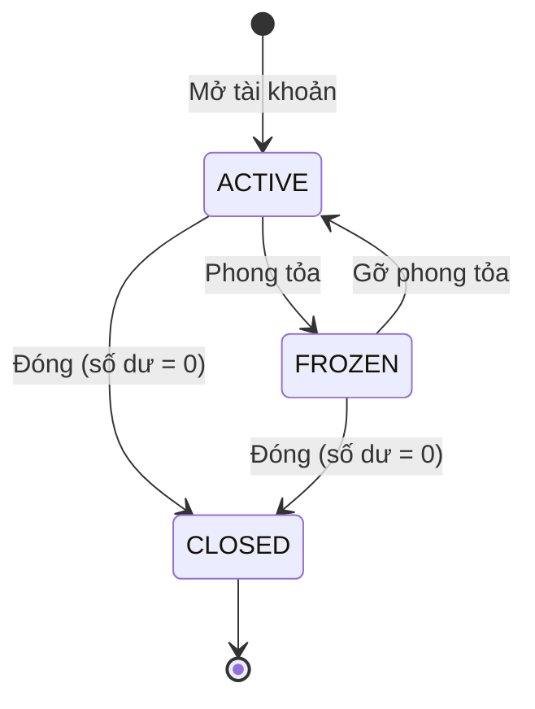

- Chỉ đóng được tài khoản có số dư bằng 0 (`BALANCE_NOT_ZERO`); khi đóng thì ghi lại thời điểm đóng.
- Tài khoản `CLOSED` không thay đổi trạng thái được nữa (`ACCOUNT_CLOSED`).
- Tài khoản `FROZEN` không bị trừ và không được cộng tiền, nhưng **vẫn nhận lại tiền hoàn** của chính giao dịch đã trừ từ nó.

### 5.4 Tra cứu

| API | Nghiệp vụ |
|---|---|
| `GET /api/accounts/me` | Các tài khoản của khách hàng đang đăng nhập |
| `GET /api/accounts?customerId=` | Nhân viên xem tài khoản của một khách hàng |
| `GET /api/accounts/{accountNumber}` | Chi tiết tài khoản (chủ tài khoản hoặc nhân viên) |
| `GET /api/accounts/{accountNumber}/ledger` | Sổ cái, phân trang, mới nhất trước |

### 5.5 Sổ cái và quy tắc thay đổi số dư

Mọi thay đổi số dư đều do lệnh từ Saga (Kafka) gây ra và được ghi vào `ACCOUNT_LEDGER_ENTRIES`:
mã giao dịch, loại bút toán `DEBIT`/`CREDIT`, số tiền (> 0), số dư sau giao dịch, diễn giải.

| Lệnh | Điều kiện thành công | Kết quả lỗi |
|---|---|---|
| Trừ tiền (`DEBIT`) | Số tiền > 0, tài khoản tồn tại, `ACTIVE`, cùng loại tiền, số dư khả dụng đủ | `ACCOUNT_DEBIT_FAILED` + lý do |
| Cộng tiền (`CREDIT`) | Số tiền > 0, tài khoản tồn tại, `ACTIVE`, cùng loại tiền | `ACCOUNT_CREDIT_FAILED` + lý do |
| Hoàn tiền (`CREDIT` "Hoàn tiền giao dịch …") | Có bút toán DEBIT của chính giao dịch đó, số tiền khớp, tài khoản chưa `CLOSED` | `ACCOUNT_REFUND_FAILED` + lý do |

- Mỗi lệnh khóa dòng tài khoản (`SELECT ... FOR UPDATE`) để tránh hai giao dịch cùng sửa số dư.
- Chống xử lý trùng: bút toán là duy nhất theo (tài khoản, mã giao dịch, loại bút toán). Nếu lệnh đến lần nữa,
  hệ thống trả lại kết quả cũ, không trừ/cộng lần hai.
- Lỗi nghiệp vụ không ném exception mà trả về event `*_FAILED` để Saga xử lý tiếp.

---

## 6. Giao dịch (transaction-service)

### 6.1 Các loại giao dịch

| Loại | API | Ai được làm | Kiểm tra khi tiếp nhận |
|---|---|---|---|
| `TRANSFER` — chuyển khoản | `POST /api/transactions/transfer` | `TRANSFER_CREATE` (khách hàng, nhân viên) | Hai tài khoản khác nhau; khách hàng phải là chủ tài khoản nguồn; cả hai `ACTIVE`; cùng loại tiền; số dư khả dụng đủ. Nhân viên chuyển (không OTP) → ghi audit `STAFF_TRANSFER_CREATED` |
| `DEPOSIT` — nộp tiền mặt | `POST /api/transactions/deposit` | `TRANSFER_CREATE` + `TELLER`/`ADMIN` | Tài khoản nhận `ACTIVE` |
| `WITHDRAWAL` — rút tiền mặt | `POST /api/transactions/withdrawal` | `TRANSFER_CREATE` + `TELLER`/`ADMIN` | Tài khoản nguồn `ACTIVE`; số dư khả dụng đủ |

- Số tiền > 0, tối đa 15 chữ số phần nguyên và 4 chữ số thập phân. Diễn giải tối đa 255 ký tự.
- Loại tiền của giao dịch lấy theo tài khoản.
- Kiểm tra số dư lúc tiếp nhận chỉ để báo lỗi sớm; account-service kiểm tra lại khi trừ tiền và đó mới là kết quả cuối cùng.
- Mã giao dịch: `TX` + `yyyyMMddHHmmss` + 8 số ngẫu nhiên.
- Phí (`FEE`) hiện luôn bằng 0.

### 6.2 Chống gửi trùng — header `Idempotency-Key`

- Bắt buộc, 8–40 ký tự (chữ, số, `-`, `_`); sai định dạng → `INVALID_IDEMPOTENCY_KEY`.
- Key lưu theo phạm vi user (`<userId>:<key>`), nên hai user dùng cùng key không ảnh hưởng nhau.
- Gửi lại cùng key, cùng nội dung (loại, tài khoản nguồn/nhận, số tiền) → trả về giao dịch đã tạo, không tạo giao dịch mới.
- Cùng key nhưng khác nội dung → 409 `IDEMPOTENCY_KEY_CONFLICT`.
- Hai request cùng key gửi song song: request đến sau nhận lại giao dịch của request đến trước.

### 6.3 Xử lý bất đồng bộ

- API tạo giao dịch trả **202 Accepted** với trạng thái `PROCESSING` và `transactionRef`.
- Kết quả cuối cùng tra bằng `GET /api/transactions/{transactionRef}`. Khách hàng chỉ xem được giao dịch có tài khoản nguồn hoặc nhận thuộc về mình.
- Lịch sử: `GET /api/transactions?accountNumber=` (phân trang, mới nhất trước); khách hàng chỉ xem được tài khoản của mình.

### 6.4 Trạng thái và các bước Saga

| Trạng thái (`STATUS`) | Ý nghĩa |
|---|---|
| `PROCESSING` | Đang xử lý |
| `COMPLETED` | Thành công |
| `FAILED` | Thất bại, không có tiền nào bị trừ (hoặc đã xử lý xong lỗi) |
| `COMPENSATED` | Đã trừ tiền nhưng cộng tiền lỗi, tiền đã được hoàn về tài khoản nguồn |
| `MANUAL_REVIEW` | Gửi lại lệnh quá số lần cho phép mà chưa có kết quả, chờ nhân viên xử lý. Kết quả đến muộn vẫn được áp dụng tiếp |
| `PENDING` | Chờ khách hàng xác nhận OTP (chưa trừ tiền); hết hạn hoặc nhập sai quá số lần → `FAILED` |

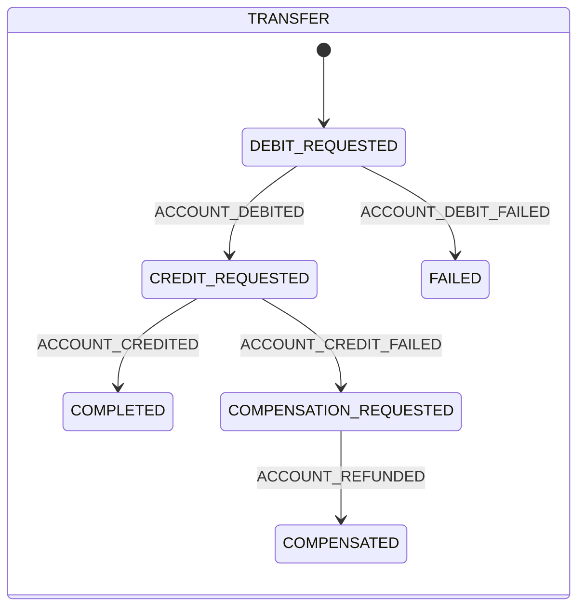

- `WITHDRAWAL`: `DEBIT_REQUESTED` → `COMPLETED` (trừ được tiền) hoặc `FAILED`.
- `DEPOSIT`: `CREDIT_REQUESTED` → `COMPLETED` (cộng được tiền) hoặc `FAILED`.
- Event chỉ được áp dụng khi giao dịch đang ở đúng bước chờ event đó. Event lặp lại hoặc đến muộn bị bỏ qua.
- Trường hợp đặc biệt: nhận `ACCOUNT_DEBITED` khi giao dịch đã `FAILED` (lệnh trừ tiền bị xử lý lại) → hệ thống tự gửi lệnh hoàn tiền để khách không mất tiền.
- Hoàn tiền thất bại (ví dụ tài khoản nguồn đã đóng): ghi lý do vào giao dịch, log mức ERROR; job quá hạn gửi lại lệnh hoàn tiền rồi chuyển `MANUAL_REVIEW`.
- **Cộng tiền đến muộn:** lệnh cộng tiền gửi lại (do quá hạn) thành công sau khi chuyển khoản đã sang bù trừ, hoặc nộp tiền đã thất bại → tài khoản nhận bị cộng thừa. Giao dịch chuyển `MANUAL_REVIEW` với lý do "Cộng tiền đến muộn…" (giữ nguyên kể cả khi hoàn tiền về sau); hệ thống không tự trừ tiền khách, nhân viên thu hồi thủ công.
- **Giao dịch bị kẹt:** `SagaTimeoutMonitorService` quét mỗi 30 giây. Giao dịch chờ kết quả quá `bank.saga.step-timeout` (mặc định 2 phút), dù đang `PROCESSING` hay `FAILED` nhưng còn chờ hoàn tiền, sẽ được gửi lại lệnh của bước hiện tại. Việc này an toàn vì account-service trả lại kết quả cũ khi bút toán đã tồn tại. Sau `bank.saga.max-retries` lần (mặc định 3) thì chuyển `MANUAL_REVIEW`.
- Mọi lệnh và event do Saga gửi ra đều được ghi vào bảng outbox trong cùng transaction với thay đổi trạng thái, sau đó mới publish lên Kafka. Vì vậy thay đổi trạng thái và lệnh gửi đi không bị lệch nhau.

---

## 7. Thông báo (notification-service)

### 7.1 Khi nào gửi, gửi cho ai

notification-service nhận `TRANSACTION_COMPLETED` / `TRANSACTION_FAILED` từ transaction-service.

| Giao dịch | Người nhận | Thành công | Thất bại / hoàn tiền |
|---|---|---|---|
| `TRANSFER` | Chủ tài khoản nguồn | SMS + Email (`TRANSFER_SUCCESS`) | Email (`TRANSFER_FAILED`) |
| `WITHDRAWAL` | Chủ tài khoản nguồn | SMS + Email | Email |
| `DEPOSIT` | Chủ tài khoản nhận | Email (mẫu SMS chỉ dành cho giao dịch trừ tiền) | Email |

- Địa chỉ nhận lấy từ hồ sơ khách hàng (số điện thoại / email). Hồ sơ thiếu thông tin thì bỏ qua kênh đó.
- Mẫu không có hoặc đang tắt thì bỏ qua kênh đó.
- Giao dịch kết thúc bằng `COMPENSATED` gửi thông báo thất bại.

### 7.2 Mẫu thông báo (seed trong `05_notification_schema.sql`)

| Mã | Kênh | Nội dung |
|---|---|---|
| `TRANSFER_SUCCESS` | SMS | `TK {accountNumber} -{amount} {currency} luc {time}. Ma GD: {transactionRef}. So du: {balance}` |
| `TRANSFER_SUCCESS` | EMAIL | Tài khoản {accountNumber} vừa thực hiện giao dịch {amount} {currency} lúc {time}. Mã giao dịch: {transactionRef}. |
| `TRANSFER_FAILED` | EMAIL | Giao dịch {transactionRef} số tiền {amount} {currency} không thành công. Lý do: {reason}. |

- Placeholder: `{accountNumber}` (đã che), `{amount}`, `{currency}`, `{transactionRef}`, `{balance}` (số dư khả dụng tại thời điểm gửi),
  `{reason}`, `{time}` (giờ Việt Nam, `HH:mm dd/MM/yyyy`). Số tiền định dạng theo locale `vi-VN`.
- `ADMIN` xem và sửa mẫu qua `GET/PUT /api/notification-templates` (tiêu đề, nội dung, bật/tắt). Mẫu được cache và cache bị xóa khi sửa.

### 7.3 Gửi, chống trùng và gửi lại

- Mỗi thông báo là duy nhất theo (`EVENT_ID`, `CHANNEL`), nên event nhận lại không bị gửi hai lần.
- Gửi lỗi → `FAILED`; job chạy mỗi 60 giây gửi lại các thông báo `FAILED` cho tới khi đủ 3 lần thử.
- Email gửi qua SMTP, SMS qua HTTP API của nhà cung cấp brandname (nội dung SMS tự bỏ dấu tiếng Việt). Môi trường dev: email vào Mailpit (`http://localhost:8025`), SMS chỉ ghi log (đã che người nhận, không ghi nội dung).
- Lỗi tạm thời (mất kết nối, nhà cung cấp quá tải / lỗi 5xx) mới được gửi lại; người nhận bị nhà cung cấp từ chối (số điện thoại / email sai) → `FAILED` ngay, không gửi lại.
- Khách hàng xem thông báo của mình: `GET /api/notifications/me`; nhân viên (`CUSTOMER_MANAGE`) xem theo khách hàng: `GET /api/notifications?customerId=`.

---

## 8. Luồng xử lý dữ liệu (sequence diagram)

### 8.1 Đăng nhập và gọi API qua gateway

Mọi request đi qua api-gateway. Gateway giới hạn tần suất (20 request/giây, burst 40) theo userId, hoặc theo IP với request chưa đăng nhập.
Gateway kiểm tra JWT rồi chuyển tiếp nguyên header `Authorization`, và service đích kiểm tra quyền lần nữa.

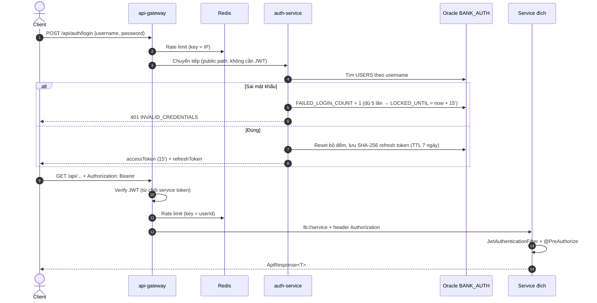

### 8.2 Làm mới token (xoay vòng)

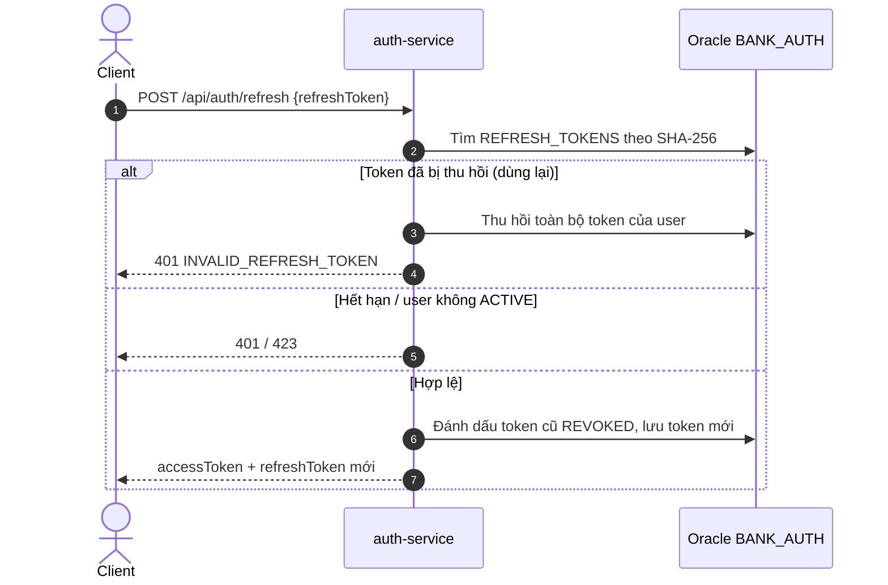

### 8.3 Tạo hồ sơ khách hàng và KYC

Duyệt giấy tờ (bước 7–8) và xác nhận KYC (bước 9–10) là hai thao tác riêng của nhân viên.

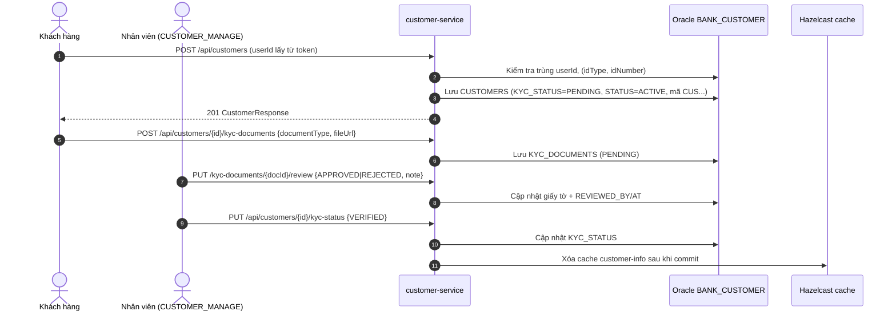

### 8.4 Mở tài khoản

account-service gọi REST trực tiếp (không dùng cache) để có trạng thái KYC mới nhất.

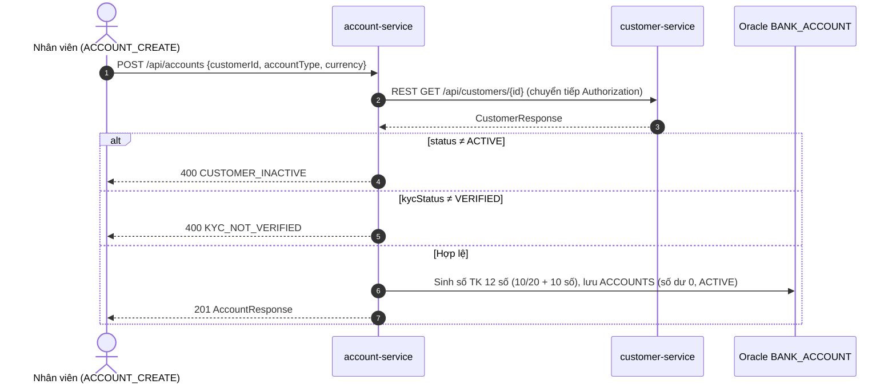

### 8.5 Chuyển khoản thành công (Saga + Outbox)

- Bước 1–9 chạy đồng bộ trong request của client. Từ bước 10 trở đi chạy bất đồng bộ.
- OutboxPublisher quét outbox mỗi 500ms. Kafka dùng `transactionRef` làm key để các message của một giao dịch giữ đúng thứ tự.

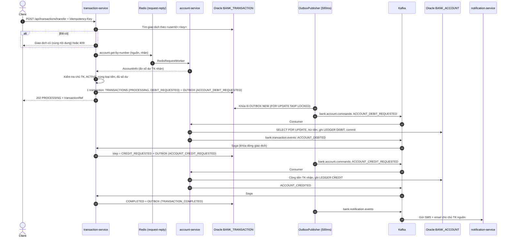

### 8.6 Chuyển khoản lỗi và bù trừ

```mermaid
sequenceDiagram
    autonumber
    participant TS as transaction-service (Saga)
    participant K as Kafka
    participant AS as account-service
    Note over TS,AS: Trường hợp A — trừ tiền lỗi (không đủ số dư, TK FROZEN, sai loại tiền)
    AS->>K: ACCOUNT_DEBIT_FAILED {reason}
    K->>TS: FAILED + TRANSACTION_FAILED (email)
    Note over TS,AS: Trường hợp B — đã trừ tiền, cộng tiền lỗi
    AS->>K: ACCOUNT_CREDIT_FAILED {reason}
    K->>TS: step = COMPENSATION_REQUESTED
    TS->>K: ACCOUNT_REFUND_REQUESTED (qua outbox)
    K->>AS: Hoàn tiền TK nguồn (kiểm tra bút toán DEBIT, đúng số tiền; FROZEN vẫn nhận)
    alt Hoàn tiền thành công
        AS->>K: ACCOUNT_REFUNDED
        K->>TS: COMPENSATED + TRANSACTION_FAILED (email)
    else Hoàn tiền lỗi (TK đã đóng...)
        AS->>K: ACCOUNT_REFUND_FAILED
        K->>TS: Ghi failureReason, log ERROR → xử lý thủ công
    end
    Note over TS,AS: Trường hợp C — ACCOUNT_DEBITED đến khi giao dịch đã FAILED → tự gửi lệnh hoàn tiền
```

### 8.7 Nộp tiền / rút tiền tại quầy

Mỗi giao dịch chỉ có một lệnh nên không có bước bù trừ.

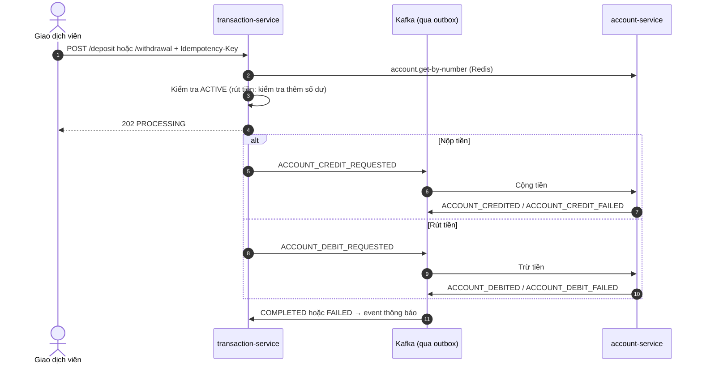

### 8.8 Client tra kết quả giao dịch

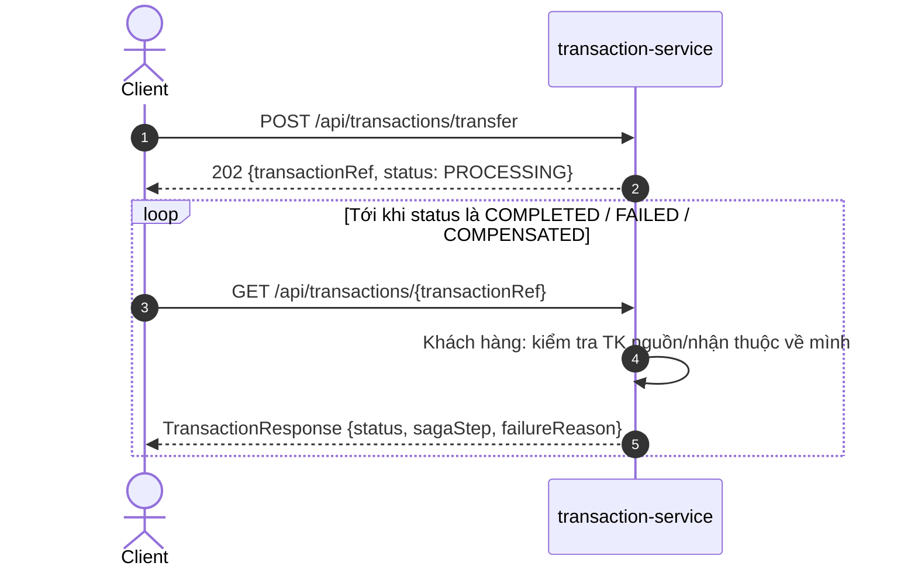

### 8.9 Gửi thông báo

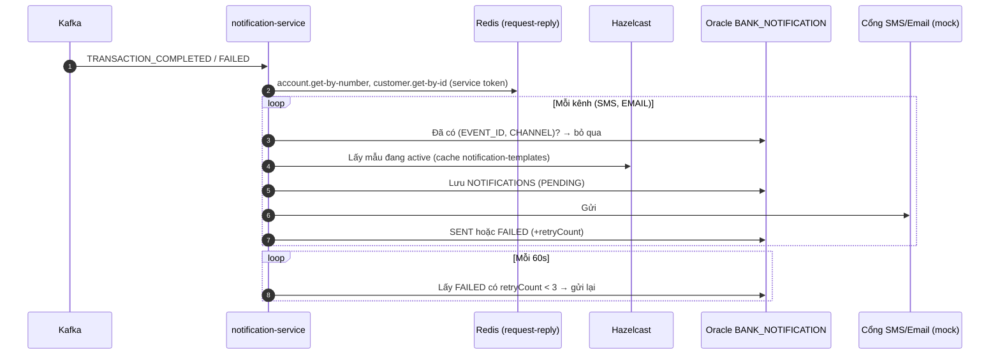

### 8.10 Luồng nghiệp vụ end-to-end

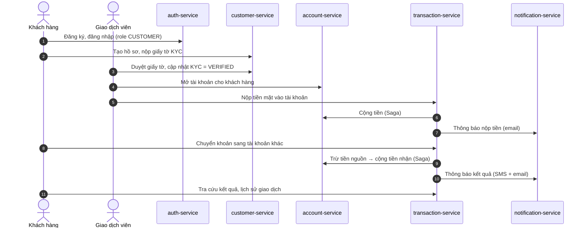

---

## 9. Mã lỗi nghiệp vụ thường gặp

Response lỗi bọc trong `ApiResponse` và có mã lỗi (`code`).

| HTTP | Mã | Khi nào |
|---|---|---|
| 400 | `SAME_ACCOUNT` | Tài khoản nguồn trùng tài khoản nhận |
| 400 | `ACCOUNT_NOT_ACTIVE` | Tài khoản nguồn/nhận không `ACTIVE` |
| 400 | `CUSTOMER_NOT_ACTIVE` | Chuyển khoản / rút tiền khi khách hàng chủ tài khoản nguồn không `ACTIVE` |
| 400 | `CURRENCY_MISMATCH` | Hai tài khoản khác loại tiền |
| 400 | `INSUFFICIENT_BALANCE` | Số dư khả dụng không đủ (kiểm tra sớm) |
| 400 | `INVALID_IDEMPOTENCY_KEY` | Thiếu hoặc sai định dạng `Idempotency-Key` |
| 409 | `IDEMPOTENCY_KEY_CONFLICT` | Key đã dùng cho giao dịch có nội dung khác |
| 400 | `CUSTOMER_INACTIVE` | Mở tài khoản cho khách hàng không `ACTIVE` |
| 400 | `KYC_NOT_VERIFIED` | Mở tài khoản khi KYC chưa `VERIFIED` |
| 400 | `BALANCE_NOT_ZERO` | Đóng tài khoản còn số dư |
| 400 | `ACCOUNT_CLOSED` | Đổi trạng thái tài khoản đã đóng |
| 409 | `CUSTOMER_ALREADY_EXISTS` | User đã có hồ sơ / số giấy tờ đã đăng ký |
| 409 | `USER_ALREADY_EXISTS` | Username hoặc email đã tồn tại |
| 400 | `INVALID_ROLE` | Gán role không tồn tại |
| 400 | `CANNOT_LOCK_SELF` | Tự khóa tài khoản của mình |
| 401 | `INVALID_CREDENTIALS` | Sai username/mật khẩu |
| 401 | `INVALID_REFRESH_TOKEN` | Refresh token sai, hết hạn hoặc đã bị thu hồi |
| 423 | `ACCOUNT_LOCKED` | User bị khóa/vô hiệu hóa hoặc đang tạm khóa do đăng nhập sai |
| 403 | `FORBIDDEN` | Không có quyền / không phải chủ sở hữu dữ liệu |
| 404 | `ACCOUNT_NOT_FOUND`, `CUSTOMER_NOT_FOUND`, `TRANSACTION_NOT_FOUND`, `USER_NOT_FOUND`, `KYC_DOCUMENT_NOT_FOUND`, `TEMPLATE_NOT_FOUND` | Không tìm thấy dữ liệu |
| 504 | `SERVICE_TIMEOUT` | Service đích không trả lời kênh Redis trong 5 giây |

Lỗi xảy ra trong lúc Saga chạy (không đủ số dư thực tế, tài khoản bị phong tỏa giữa chừng…) không trả về API tạo giao dịch.
Lỗi đó nằm trong `failureReason` của giao dịch, có `status = FAILED`.

---

## 10. Chức năng bổ sung (vận hành, kiểm soát rủi ro, mở rộng)

### 10.1 Phí giao dịch
- Biểu phí theo loại giao dịch + loại tiền (`GET /api/fee-schedules`, ADMIN sửa bằng `PUT /api/fee-schedules/{id}`):
  phí = phí cố định + số tiền × tỉ lệ, chặn trong [tối thiểu, tối đa], làm tròn theo loại tiền (VND không lẻ).
- Dữ liệu mẫu: chuyển khoản VND 0,02%, tối thiểu 2.000, tối đa 20.000; USD/EUR 1 mỗi giao dịch. Nộp/rút tiền chưa thu phí.
- Phí thu trên tài khoản nguồn: số dư phải đủ **số tiền + phí**. Sổ cái ghi một bút toán DEBIT (số tiền + phí) ở tài khoản nguồn
  và một bút toán CREDIT phí ở tài khoản thu phí nội bộ (`990000000001` VND...). Giao dịch được bù trừ thì hoàn cả phí.
- Tài khoản nội bộ (loại `INTERNAL`) không mở được qua API và không dùng được trong giao dịch của khách hàng (`INTERNAL_ACCOUNT`).

### 10.2 Hạn mức giao dịch
- Theo loại giao dịch, loại tài khoản (riêng cho SAVINGS hoặc chung) và loại tiền: tối đa mỗi giao dịch, tổng trong ngày, số giao dịch trong ngày.
  Xem `GET /api/transaction-limits`, ADMIN sửa bằng `PUT /api/transaction-limits/{id}` (để trống = không giới hạn).
- Tính trên tài khoản nguồn (chuyển khoản, rút tiền) hoặc tài khoản nhận (nộp tiền), từ 00:00 mỗi ngày, không tính giao dịch thất bại/đã hoàn.
  Giao dịch chờ OTP được tính ngay. Lỗi: `LIMIT_PER_TRANSACTION_EXCEEDED`, `LIMIT_DAILY_AMOUNT_EXCEEDED`, `LIMIT_DAILY_COUNT_EXCEEDED`.

### 10.3 OTP xác nhận chuyển khoản
- Khách hàng tự chuyển khoản từ 10.000.000 VND (500 USD/EUR) trở lên: giao dịch ở trạng thái `PENDING`, OTP 6 số gửi qua SMS (hiệu lực 3 phút).
- `POST /api/transactions/{ref}/confirm` `{"otp":"123456"}` → `PROCESSING`. Chỉ người tạo giao dịch được xác nhận.
  Sai OTP: `INVALID_OTP` (báo số lần còn lại); sai 5 lần: hủy giao dịch (`OTP_ATTEMPTS_EXCEEDED`); OTP hết hạn: `OTP_EXPIRED`.
- `POST /api/transactions/{ref}/otp`: gửi lại OTP (tối đa 3 lần). Giao dịch chờ quá 10 phút tự bị hủy.
- Nhân viên (TELLER/ADMIN) và lệnh định kỳ không cần OTP. Nội dung SMS lưu trong lịch sử thông báo đã che mã OTP.

### 10.4 Tạm giữ tiền (phong tỏa một phần)
- Nhân viên (`ACCOUNT_UPDATE`): `POST /api/accounts/{no}/holds` `{amount, reason, expiresAt?}` và `POST .../holds/{id}/release`.
  Chủ tài khoản xem được danh sách `GET .../holds`.
- Tiền tạm giữ giảm **số dư khả dụng**, số dư sổ sách giữ nguyên; giao dịch chỉ dùng được số dư khả dụng. Hết `expiresAt` thì tự giải tỏa.

### 10.5 Sao kê
- `GET /api/accounts/{no}/statement?from=yyyy-MM-dd&to=yyyy-MM-dd`: số dư đầu kỳ, các bút toán, tổng ghi nợ/ghi có, số dư cuối kỳ (tối đa 366 ngày).
- `GET .../statement/export?from&to&format=pdf|csv`: tải file PDF hoặc CSV (UTF-8, mở được bằng Excel). Chủ tài khoản hoặc nhân viên.

### 10.6 Danh bạ người nhận và chuyển tiền định kỳ (khách hàng)
- `GET/POST /api/beneficiaries`, `DELETE /api/beneficiaries/{id}`: lưu tối đa 100 tài khoản nhận kèm tên gợi nhớ.
- `POST /api/scheduled-transfers` `{fromAccountNumber, toAccountNumber, amount, description, frequency: DAILY|WEEKLY|MONTHLY, startDate, endDate?}`,
  `GET /api/scheduled-transfers`, `POST /api/scheduled-transfers/{id}/cancel`.
- Hệ thống kiểm tra mỗi 5 phút và tạo giao dịch cho kỳ đến hạn (mỗi kỳ chỉ một giao dịch). Không đủ tiền / vượt hạn mức: ghi lỗi vào lệnh và chuyển sang kỳ sau.
  Các kỳ bị lỡ khi hệ thống dừng nhiều ngày: chỉ thực hiện một lần cho kỳ cũ nhất. Qua ngày kết thúc → `COMPLETED`.

### 10.7 Thông báo
- Chuyển khoản thành công: người chuyển nhận `TRANSFER_SUCCESS` (có phí), **người nhận** nhận `TRANSFER_RECEIVED` (SMS + email).
- Nộp tiền: `DEPOSIT_SUCCESS` / `DEPOSIT_FAILED`; rút tiền: `WITHDRAWAL_SUCCESS` / `WITHDRAWAL_FAILED`; OTP: `TRANSACTION_OTP` (SMS).

### 10.8 KYC
- Khi nhân viên duyệt `APPROVED` đủ ba giấy tờ `ID_FRONT`, `ID_BACK`, `PORTRAIT`, `KYC_STATUS` tự chuyển `VERIFIED` (tắt bằng `bank.kyc.auto-verify=false`).

### 10.9 Vận hành (ADMIN, permission `OPERATION_MANAGE`)
| API | Nghiệp vụ |
|---|---|
| `GET /api/admin/transactions?status=MANUAL_REVIEW` | Giao dịch cần xử lý thủ công |
| `POST /api/admin/transactions/{ref}/retry` | Gửi lại lệnh của bước đang chờ (sau khi đã khắc phục sự cố) |
| `GET /api/admin/outbox?status=FAILED`, `POST /api/admin/outbox/{id}/replay` | Event không publish được lên Kafka |
| `GET /api/admin/dead-letters`, `POST .../{id}/replay`, `POST .../{id}/ignore` | Message lỗi sau khi retry (DLT) của mọi service |
| `POST /api/admin/ledger-reconciliation/run`, `GET .../issues`, `POST .../issues/{id}/resolve` | Đối soát số dư với sổ cái (tự chạy 01:30 hằng ngày) |
| `POST /api/admin/transaction-reconciliation/run?from&to`, `GET .../issues` | Đối soát giao dịch với bút toán (tự chạy 02:00 cho ngày hôm trước) |
| `GET /api/audit-logs?actorUserId&action&targetType&targetId` (ADMIN) | Lịch sử thao tác của nhân viên trên toàn hệ thống |

- Khóa user hoặc đổi role: mọi access token đang dùng của user **bị vô hiệu ngay**, user phải đăng nhập lại.
- Một service đích lỗi liên tục: các lời gọi tới nó bị từ chối ngay (`SERVICE_UNAVAILABLE` 503) trong 30 giây thay vì chờ timeout.

### 10.10 Giới hạn hiện tại
- **Chưa hỗ trợ chuyển khác loại tiền** (không quy đổi ngoại tệ).
- **Khách hàng không tự mở tài khoản được**, vì chỉ nhân viên có `ACCOUNT_CREATE`.
- Thông báo gửi lỗi đủ 3 lần chỉ được ghi nhận, chưa có màn hình xử lý; OTP gửi lỗi thì khách hàng yêu cầu gửi lại.

## 11. Khởi động hệ thống local

### 11.1 Điều kiện

- JDK 21, Maven, Docker Desktop.
- Oracle 19c chạy tại `localhost:1521`, SID `orcl`, đã chạy các script `database/oracle/00_`–`05_`.
  Khi chạy sqlplus luôn đặt `NLS_LANG=AMERICAN_AMERICA.AL32UTF8`.

### 11.2 Thứ tự khởi động

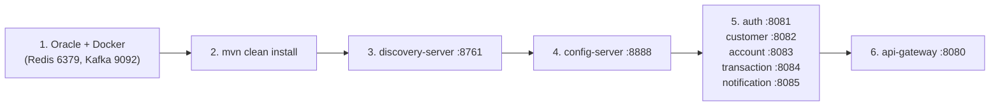

| Bước | Thành phần | Lý do phải chạy ở bước này |
|---|---|---|
| 1 | Oracle, `docker compose up -d` | Các service cần DB (Hibernate `validate` lúc khởi động), Redis và Kafka |
| 2 | `mvn clean install -DskipTests` | Build `common-lib` và các jar |
| 3 | `discovery-server` | Các service khác đăng ký vào Eureka |
| 4 | `config-server` | Service import cấu hình bằng `spring.config.import=configserver:` (không optional), thiếu config-server thì service không khởi động được |
| 5 | 5 service nghiệp vụ (thứ tự tùy ý) | Gọi nhau qua Eureka / Redis / Kafka lúc chạy, không phụ thuộc thứ tự khởi động |
| 6 | `api-gateway` | Định tuyến `lb://` tới các service đã đăng ký |

### 11.3 Lệnh chạy

```bash
# Hạ tầng
docker compose up -d

# Build
mvn clean install -DskipTests

# Mỗi service một terminal, theo thứ tự ở trên
mvn -pl discovery-server spring-boot:run
mvn -pl config-server spring-boot:run
mvn -pl auth-service spring-boot:run
mvn -pl customer-service spring-boot:run
mvn -pl account-service spring-boot:run
mvn -pl transaction-service spring-boot:run
mvn -pl notification-service spring-boot:run
mvn -pl api-gateway spring-boot:run

# Hoặc chạy jar
java -jar account-service/target/account-service-1.0.0-SNAPSHOT.jar
```

### 11.4 Kiểm tra

1. Mở Eureka `http://localhost:8761` và xác nhận đủ các service đã đăng ký.
   Sau khi khởi động cần đợi khoảng 30 giây thì route `lb://` của gateway mới hoạt động.
2. Đăng nhập qua gateway bằng tài khoản quản trị được tạo tự động:

   ```bash
   curl -X POST http://localhost:8080/api/auth/login \
        -H "Content-Type: application/json" \
        -d '{"username":"admin","password":"Admin@123456"}'
   ```

3. Gọi API với `Authorization: Bearer <accessToken>`. JSON có tiếng Việt cần gửi bằng file
   (`--data-binary @file.json`); nếu truyền thẳng trong tham số trên Git Bash, chuỗi bị sai mã hóa và trả 400.

### 11.5 Lỗi thường gặp

| Hiện tượng | Nguyên nhân / cách xử lý |
|---|---|
| Service không khởi động, lỗi lấy cấu hình | config-server chưa chạy → khởi động config-server trước |
| Gọi qua gateway bị lỗi ngay sau khi khởi động | Service chưa đăng ký Eureka → đợi khoảng 30 giây |
| `mvn install` lỗi "Unable to rename ... .jar" (Windows) | Service đang chạy khóa file jar → dừng service hoặc loại module: `-pl '!discovery-server,!config-server'` |
| Dữ liệu tiếng Việt bị lỗi font trong DB | Chạy sqlplus thiếu `NLS_LANG=AMERICAN_AMERICA.AL32UTF8` |
| Hibernate validate lỗi khi khởi động | Schema DB chưa khớp entity → chạy/sửa script trong `database/oracle/` (Hibernate không tự sinh bảng) |
